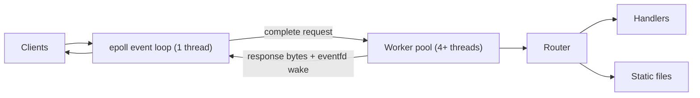

# cpp-http-server

[](https://github.com/nerofly126-oss/cpp-http-server/actions/workflows/ci.yml)

An HTTP/1.1 server written from scratch in C++17 on raw Linux sockets. No frameworks, no networking libraries: just `epoll`, a thread pool, and a hand-written request parser.

It is a learning project, not a replacement for nginx. The point was to understand what a framework like Express hides, and to build it with the same care a production server needs: limits, timeouts, sanitizers, fuzzing, and tests.

## Features

- **Event loop:** one `epoll` thread owns every socket, all non-blocking, level-triggered.
- **Worker pool:** complete requests are handed to a thread pool, so slow handlers (disk reads, sleeps) never stall other clients.
- **HTTP/1.1:** keep-alive, pipelining, `HEAD`, `Content-Length` bodies, percent-decoded paths, query strings, correct `405` with an `Allow` header.
- **Static files:** MIME types, `index.html` for directories, and path traversal protection that resolves `..` and symlinks before checking the web root.
- **Hardening:** size and count limits, per-request deadlines, per-IP connection cap, and strict header parsing (see below).

## Architecture



The life of a request:

1. The event loop accepts the connection and reads whatever bytes have arrived.
2. `parse_request` looks at the buffer and answers one of three things: incomplete (wait for more bytes), complete (here is the request and how many bytes it used), or an error status. It never touches a socket.
3. A complete request goes to the worker pool. The connection is marked busy, so only one request per connection is in flight and pipelined responses stay in order.
4. A worker runs the router, serializes the response, and wakes the loop through an `eventfd`.
5. The loop writes the response (waiting for `EPOLLOUT` if the socket buffer is full), then either closes the connection or parses the next pipelined request.

Design decisions worth knowing:

- Connections are looked up by a monotonically increasing id, never by pointer or file descriptor. A worker finishing after its client left, or a stale event in the same `epoll_wait` batch, then finds nothing and is dropped safely.
- All connection state is touched by the event loop thread only. Workers communicate through one mutex-protected queue plus the `eventfd`.
- A client that half-closes its side still receives its response.

## Build and run

Requires Linux (it uses `epoll`), a C++17 compiler, and CMake 3.16 or newer.

```
cmake -S . -B build
cmake --build build -j
./build/httpserver 8080
```

Or with plain g++:

```
g++ -std=c++17 -O2 -pthread src/*.cpp -o httpserver
./httpserver 8080
```

Usage: `httpserver [port] [static_dir] [-q]`. The default port is 8080, the default static directory is `./static`, and `-q` turns off per-request logging (use it when benchmarking).

Built-in routes: `GET /health`, `POST /echo`, and `GET /slow` (sleeps 2 seconds, to demonstrate that other clients are not blocked). Everything else is served from the static directory.

## Limits and hardening

| Protection | Value |
|---|---|
| Header block size | 8 KB, otherwise `431` |
| Number of headers | 100, otherwise `431` |
| Request body size | 1 MB, otherwise `413` |
| Idle connection | closed after 10 s of silence |
| Request deadline | 15 s from the first byte, otherwise `408` |
| Connections per IP | 256 |
| Total connections | 10,000 |

The parser also rejects control characters (NUL, bare CR or LF) in the request line and headers, conflicting `Content-Length` values, and `Transfer-Encoding` bodies (`501`). These are the usual ingredients of request smuggling.

**Slowloris:** a client that sends one byte every two seconds never looks idle, so an inactivity timeout alone does not catch it. The first version of this server was still holding such a connection when I stopped the test after 30 seconds. With the per-request deadline it is dropped after about 15 seconds. The integration test reproduces the attack.

## Testing

- **Unit tests** (`tests/unit_tests.cpp`, 21 tests): parser edge cases (including checking that every prefix of a request body reports "incomplete"), serializer, router, and static files with real symlink escape attempts.
- **Integration tests** (`tests/integration_test.py`, 38 checks): start the real binary and talk to it over raw sockets. Covers keep-alive, pipelining, split packets, half-closed clients, parallel slow handlers, 200 concurrent connections, the per-IP cap, and the timeouts.
- **Sanitizers:** the whole suite runs under AddressSanitizer + UndefinedBehaviorSanitizer, and separately under ThreadSanitizer.
- **Fuzzing:** `tests/fuzz_parser.cpp` is a libFuzzer target that drives the parser, router, and serializer together and asserts invariants.
- **CI:** GitHub Actions runs all of the above on every push.

```
ctest --test-dir build --output-on-failure
python3 tests/integration_test.py build/httpserver --slow
```

To fuzz locally (needs clang):

```
clang++ -std=c++17 -g -O1 -fsanitize=fuzzer,address,undefined \
    tests/fuzz_parser.cpp src/http.cpp src/router.cpp -o fuzz_parser
mkdir -p /tmp/corpus && ./fuzz_parser /tmp/corpus tests/corpus -max_total_time=60
```

## Benchmarks

Measured with `wrk -t4 -c100 -d10s` against an `-O2` build with logging off (`-q`). `wrk` and the server ran on the same 4-thread machine, so treat the numbers as a way to compare runs of this server, not as a claim about absolute performance. No socket errors or non-2xx responses were reported.

| Endpoint | Requests/sec | Avg latency | Max latency |
|---|---|---|---|
| `/health` (no I/O) | 45,939 | 2.19 ms | 12.7 ms |
| `/index.html` (reads from disk) | 31,032 | 3.19 ms | 29.3 ms |

Static files are slower because every request resolves the path (`canonical`, symlink and web-root checks), then opens and reads the file. There is no cache.

## Known limitations

- Linux only (`epoll`, `eventfd`, `accept4`).
- IPv4 only, so the per-IP cap is IPv4 only too.
- No TLS, no HTTP/2, no chunked request bodies.
- Static files are read fully into memory. `sendfile()` would be the proper fix for large files.
- A request body must arrive within the 15 second deadline, so uploads need roughly 70 KB/s or better.

## Project layout

```
src/
  main.cpp          route setup, signals, argument parsing
  server.{hpp,cpp}  epoll event loop and connection state machine
  http.{hpp,cpp}    incremental request parser, response serializer
  router.{hpp,cpp}  routing, percent-decoding, static files
  thread_pool.hpp   fixed-size worker pool
  fd.hpp            RAII file descriptor
tests/              unit, integration, and fuzz tests
static/             sample web root
```
