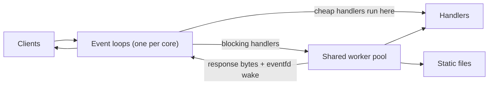

# cpp-http-server

[](https://github.com/nerofly126-oss/cpp-http-server/actions/workflows/ci.yml)

An HTTP/1.1 server written from scratch in C++17 on raw Linux sockets. No frameworks, no networking libraries: just `epoll`, a thread pool, and a hand-written request parser.

It is a learning project, not a replacement for nginx. The point was to understand what a framework like Express hides, and to build it with the same care a production server needs: limits, timeouts, sanitizers, fuzzing, and tests.

## Features

- **Event loops:** one `epoll` loop per core. Each loop owns its connections outright, and the kernel balances new connections between loops with `SO_REUSEPORT`. All sockets are non-blocking and level-triggered.
- **Worker pool:** handlers that may block (disk reads, sleeps) run on a shared thread pool, so they never stall a loop. Cheap handlers run right on the loop and skip the handoff.
- **HTTP/1.1:** keep-alive, pipelining, `HEAD`, `Content-Length` bodies, percent-decoded paths, query strings, correct `405` with an `Allow` header.
- **Static files:** MIME types, `index.html` for directories, and path traversal protection that resolves `..` and symlinks before checking the web root.
- **Hardening:** size and count limits, per-request deadlines, per-IP connection cap, and strict header parsing (see below).

## Architecture



The life of a request:

1. The kernel hands the new connection to one of the loops. That loop accepts it and reads whatever bytes have arrived.
2. `parse_request` looks at the buffer and answers one of three things: incomplete (wait for more bytes), complete (here is the request and how many bytes it used), or an error status. It never touches a socket.
3. A cheap handler (like `/health`) runs on the loop itself and the response is written immediately. Anything that may block goes to the worker pool, and the connection is marked busy, so only one request per connection is in flight and pipelined responses stay in order.
4. A worker runs the router, serializes the response, and wakes the loop that owns the connection through that loop's `eventfd`.
5. The loop writes the response (waiting for `EPOLLOUT` if the socket buffer is full), then either closes the connection or parses the next pipelined request.

Design decisions worth knowing:

- Connections are looked up by a monotonically increasing id, never by pointer or file descriptor. A worker finishing after its client left, or a stale event in the same `epoll_wait` batch, then finds nothing and is dropped safely.
- A connection belongs to exactly one loop, and only that loop's thread touches it. Workers talk back through a mutex-protected queue plus that loop's `eventfd`.
- Connection limits are shared by all loops through one limiter, because the kernel spreads a single client's connections across every loop. Its mutex is taken when a connection opens or closes, never per request.
- Pipelined requests are handled in a loop, not by recursion, so a client cannot overflow the stack by packing thousands of tiny requests into one buffer.
- `SO_REUSEPORT` would let a second copy of the server share the port silently and split the traffic, so the server refuses to start if anything already answers on its port.
- A client that half-closes its side still receives its response.

## Build and run

Requires Linux (it uses `epoll`), a C++17 compiler, and CMake 3.16 or newer.

```
cmake -S . -B build
cmake --build build -j
./build/httpserver 8080
```

Or with plain g++:

```
g++ -std=c++17 -O2 -pthread src/*.cpp -o httpserver
./httpserver 8080
```

Usage: `httpserver [port] [static_dir] [-q] [-l loops] [-w workers]`. The default port is 8080, the default static directory is `./static`, and `-q` turns off per-request logging (use it when benchmarking). `-l` sets the number of event loops (default: one per core) and `-w` the worker pool size (default: at least 4). `-l 1` gives the single-loop behaviour, which is handy for comparisons.

Built-in routes: `GET /health`, `POST /echo`, and `GET /slow` (sleeps 2 seconds, to demonstrate that other clients are not blocked). Everything else is served from the static directory.

## Limits and hardening

| Protection | Value |
|---|---|
| Header block size | 8 KB, otherwise `431` |
| Number of headers | 100, otherwise `431` |
| Request body size | 1 MB, otherwise `413` |
| Idle connection | closed after 10 s of silence |
| Request deadline | 15 s from the first byte, otherwise `408` |
| Connections per IP | 256 |
| Total connections | 10,000 |

The parser also rejects control characters (NUL, bare CR or LF) in the request line and headers, conflicting `Content-Length` values, and `Transfer-Encoding` bodies (`501`). These are the usual ingredients of request smuggling.

**Slowloris:** a client that sends one byte every two seconds never looks idle, so an inactivity timeout alone does not catch it. The first version of this server was still holding such a connection when I stopped the test after 30 seconds. With the per-request deadline it is dropped after about 15 seconds. The integration test reproduces the attack.

## Testing

- **Unit tests** (`tests/unit_tests.cpp`, 24 tests): parser edge cases (including checking that every prefix of a request body reports "incomplete"), serializer, router, the shared connection limiter under concurrent use, and static files with real symlink escape attempts.
- **Integration tests** (`tests/integration_test.py`, 42 checks): start the real binary with four event loops and talk to it over raw sockets. Covers keep-alive, pipelining (including 20,000 requests in one burst), split packets, half-closed clients, parallel slow handlers, 200 concurrent connections, the per-IP cap, refusing a port that is already taken, and the timeouts.
- **Sanitizers:** the whole suite runs under AddressSanitizer + UndefinedBehaviorSanitizer, and separately under ThreadSanitizer.
- **Fuzzing:** `tests/fuzz_parser.cpp` is a libFuzzer target that drives the parser, router, and serializer together and asserts invariants.
- **CI:** GitHub Actions runs all of the above on every push.

```
ctest --test-dir build --output-on-failure
python3 tests/integration_test.py build/httpserver --slow
```

To fuzz locally (needs clang):

```
clang++ -std=c++17 -g -O1 -fsanitize=fuzzer,address,undefined \
    tests/fuzz_parser.cpp src/http.cpp src/router.cpp -o fuzz_parser
mkdir -p /tmp/corpus && ./fuzz_parser /tmp/corpus tests/corpus -max_total_time=60
```

## Benchmarks

`bench/compare_nginx.sh` builds the server with `-O2` and benchmarks it against nginx on the same machine, serving the same file, with the same `wrk` settings (`wrk -t4 -c100 -d10s`, median of 3 runs after a 2 second warm-up). It checks that every server returns identical bytes before it starts, and it runs nginx with one worker and with one worker per hardware thread. The raw output of the run below is in `bench/results.txt`.

Machine: Intel Core i3-5157U, 4 hardware threads, Linux 6.18.7, g++ 13.3.0, nginx 1.24.0, wrk 4.1.0. `wrk` runs on the same machine as the servers and competes with them for the same four threads, so read the table as a comparison between rows of one run, not as absolute performance. Numbers from different runs or different days are not comparable: on this machine, individual runs of the same server varied by 10 to 30%.

Requests per second (median of 3):

| Server | `/health` (no I/O) | `/index.html` (reads a file) |
|---|---|---|
| cpp-http-server, 4 event loops | 102,600 | 36,000 |
| cpp-http-server, 1 event loop | 69,100 | 35,000 |
| nginx, 1 worker | 52,500 | 27,400 |
| nginx, 4 workers (`auto`) | 91,000 | 52,000 |

What the numbers say:

- **Trivial responses:** four loops are about 1.5x faster than one (102,600 against 69,100), and roughly on par with nginx's four workers (91,000). The 13% lead over nginx is about the size of the run-to-run variation, so I do not claim it. With one worker or loop each, this server is ahead by about 30%.
- **Static files:** nginx with four workers is about 1.4x faster (52,000 against 36,000). Adding event loops barely helps here (36,000 against 35,000), because static files still go through the shared worker pool. The cost is in the path resolution, the file read, and the handoff, not in the loop. I have not profiled it. The obvious next steps are caching file contents and using `sendfile()`.

nginx was configured with its access log off, `sendfile on`, `keepalive_requests` raised so it does not hang up on `wrk`, and no `open_file_cache`; turning that cache on would widen the gap on static files. The servers do not send identical headers (nginx adds `Server`, `Date`, `Last-Modified` and `ETag`), so response sizes differ slightly.

## Known limitations

- Linux only (`epoll`, `eventfd`, `accept4`).
- IPv4 only, so the per-IP cap is IPv4 only too.
- No TLS, no HTTP/2, no chunked request bodies.
- Static files are read fully into memory. `sendfile()` would be the proper fix for large files.
- Static file throughput is about 1.4x below nginx on the same machine (see Benchmarks).
- A request body must arrive within the 15 second deadline, so uploads need roughly 70 KB/s or better.

## Project layout

```
src/
  main.cpp          route setup, signals, argument parsing
  server.{hpp,cpp}  one epoll event loop and its connection state machine
  conn_limiter.hpp  per-IP and total connection limits shared by all loops
  http.{hpp,cpp}    incremental request parser, response serializer
  router.{hpp,cpp}  routing, percent-decoding, static files
  thread_pool.hpp   fixed-size worker pool
  fd.hpp            RAII file descriptor
tests/              unit, integration, and fuzz tests
static/             sample web root
```
